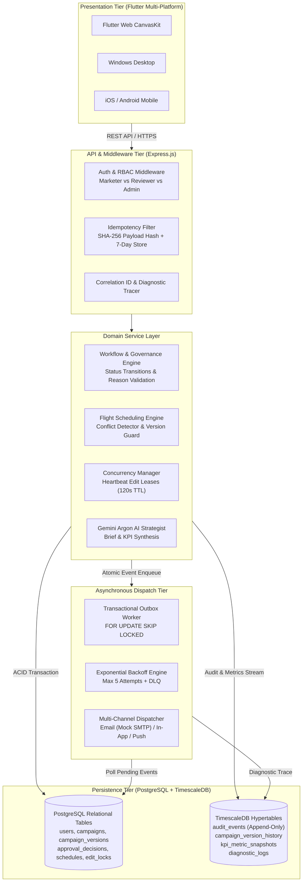
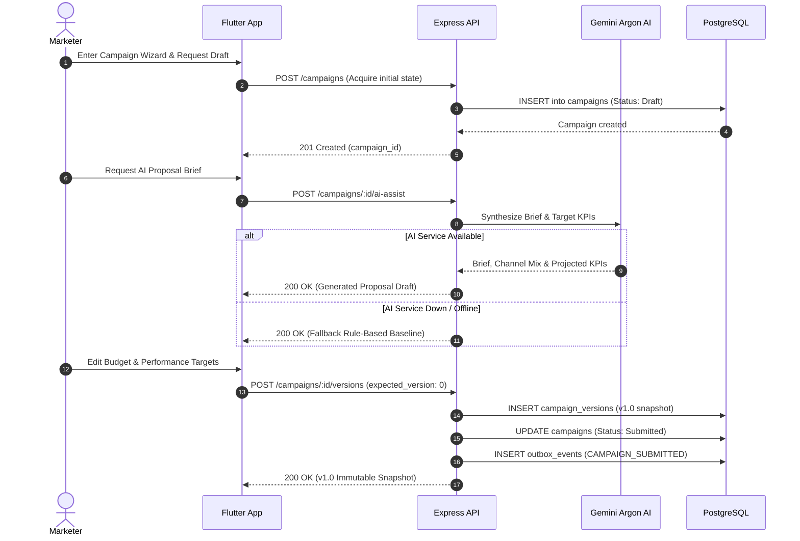
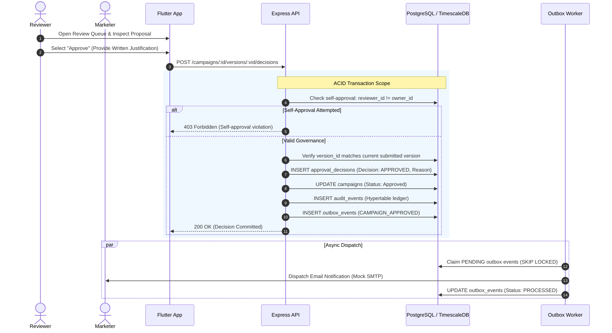
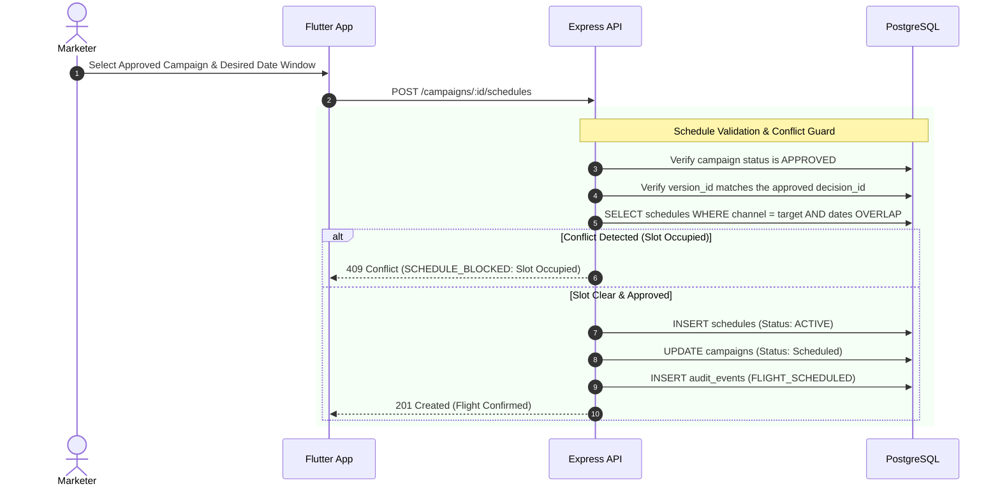
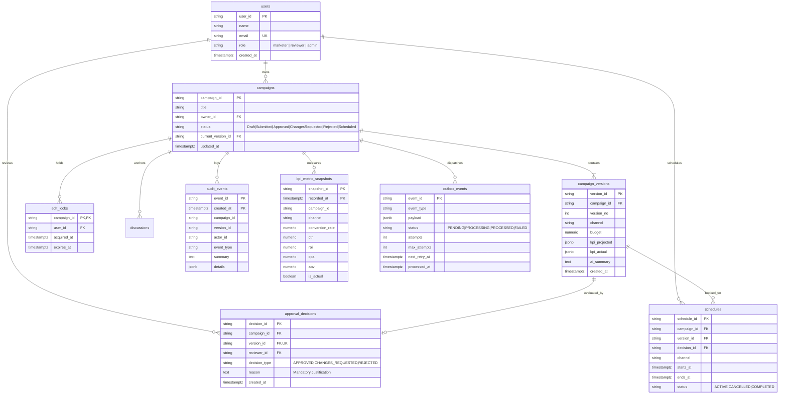
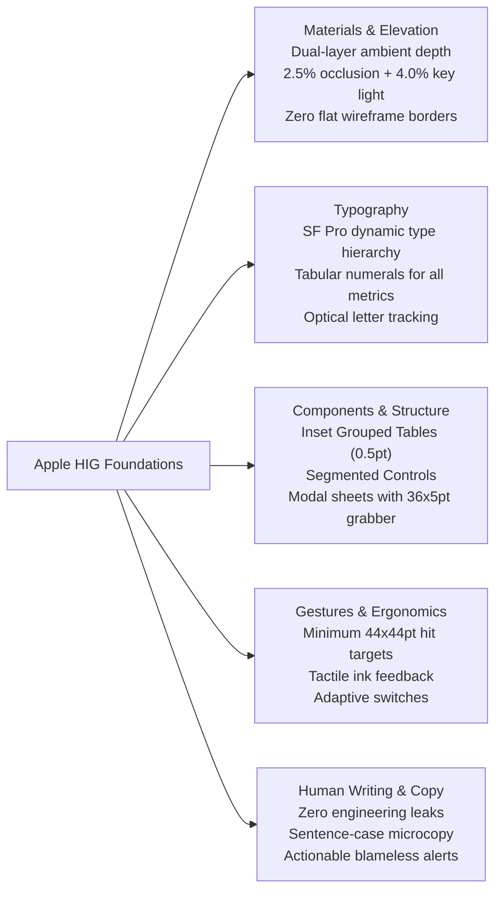

# Bit Loggers — Campaign Management & Intelligence Platform (CampaignGrid)

> **Domain:** Marketing Technology (MarTech) & Enterprise Campaign Governance  
> **Frontend:** Cross-Platform Flutter Application (Web, Desktop, iOS & Android) adhering to Apple Human Interface Guidelines (HIG)  
> **Backend:** Modular Monolith with Event-Driven Background Processing (Node.js, Express, PostgreSQL & TimescaleDB)  
> **Quality Attributes:** ACID Consistency, Idempotency, Concurrency Control, Zero Silent Overwrites, Audit Governance

---

## ⚡ Executive Summary & Vision

**Bit Loggers (CampaignGrid)** is a mission-critical campaign management and marketing intelligence platform designed for high-velocity marketing teams and rigorous campaign reviewers. It resolves the core operational challenges of multi-channel marketing:

1. **Eliminating Silent Overwrites & State Corruption**: Dual-layer concurrency combining temporary exclusive edit leases (`EDIT_LOCK`) with optimistic version headers (`expected_version`).
2. **Strict Multi-Tier Governance**: Non-negotiable review checkpoints with mandatory written justifications and cryptographic self-approval prevention (marketers cannot approve their own campaigns).
3. **Collision-Free Multi-Channel Scheduling**: Internal marketing calendar backed by conflict-detection engines ensuring no overlapping flights on the same channel window.
4. **Resilient Transactional Messaging**: Transactional Outbox pattern providing at-least-once durable notification dispatch with exponential backoff and deduplication keys (`event_id:recipient:channel`).
5. **Human Interface Craftsmanship**: Client interface built from the ground up in Flutter adhering to **Apple Human Interface Guidelines (HIG) Foundations**—featuring dual-layer ambient depth, organic squircles, Inset Grouped Tables, and tabular numerals.

---

## 🏛️ System Architecture

Bit Loggers operates as an event-driven modular monolith backed by relational persistence for transactional state and TimescaleDB hypertables for time-series analytics, audit logs, and diagnostic events.



---

## 🔄 Core User & System Flows

### 1. Proposal Drafting & Gemini Argon AI Assist Flow



---

### 2. Governance Review & Multi-Tier Approval Flow



---

### 3. Collision-Free Flight Scheduling Flow



---

## 🗄️ Relational & Time-Series Data Architecture



---

## 🎨 Presentation Layer: Apple Human Interface Guidelines (HIG)

The client presentation layer is implemented entirely in **Flutter (Dart 3.5+)** and strictly incorporates the **Apple Human Interface Guidelines (HIG) Foundations**:



### Complete Screen Implementation Portfolio (12 Screens)

| Screen | File Path | Key Capabilities |
| :--- | :--- | :--- |
| **Main Navigation** | [`lib/main.dart`](file:///c:/Users/bhavv/OneDrive/Desktop/Dravvya(4th%20Sem)/Projects/Bit_Loggers/bit_loggers_app/lib/main.dart) | Apple Inset Grouped Tab Bar, user profile switcher, real-time sync pill badge with tabular figures. |
| **Kanban Pipeline** | [`lib/screens/kanban_screen.dart`](file:///c:/Users/bhavv/OneDrive/Desktop/Dravvya(4th%20Sem)/Projects/Bit_Loggers/bit_loggers_app/lib/screens/kanban_screen.dart) | Visual lifecycle columns (`Draft` → `Scheduled`), portfolio spend burn tracker, channel flight distribution. |
| **Campaign Wizard** | [`lib/screens/campaign_wizard_screen.dart`](file:///c:/Users/bhavv/OneDrive/Desktop/Dravvya(4th%20Sem)/Projects/Bit_Loggers/bit_loggers_app/lib/screens/campaign_wizard_screen.dart) | 4-step draft builder, interactive channel cards, Vitruvian budget pacing bar, projected KPI inputs. |
| **Campaign Dossier** | [`lib/screens/campaign_detail_screen.dart`](file:///c:/Users/bhavv/OneDrive/Desktop/Dravvya(4th%20Sem)/Projects/Bit_Loggers/bit_loggers_app/lib/screens/campaign_detail_screen.dart) | Immutable proposal header, governance decision sheet, version filter chips, context-anchored discussions with `@mentions`. |
| **Flight Calendar** | [`lib/screens/calendar_screen.dart`](file:///c:/Users/bhavv/OneDrive/Desktop/Dravvya(4th%20Sem)/Projects/Bit_Loggers/bit_loggers_app/lib/screens/calendar_screen.dart) | Monthly grid with channel occupancy dots, weekly Gantt-style flight lanes, collision conflict checker. |
| **Analytics & KPIs** | [`lib/screens/analytics_screen.dart`](file:///c:/Users/bhavv/OneDrive/Desktop/Dravvya(4th%20Sem)/Projects/Bit_Loggers/bit_loggers_app/lib/screens/analytics_screen.dart) | Live telemetry charts (Conv Rate, CTR, ROI, CPA, AOV), projected vs. actual delta badges, channel yield matrix. |
| **Sync Hub & Outbox** | [`lib/screens/sync_hub_screen.dart`](file:///c:/Users/bhavv/OneDrive/Desktop/Dravvya(4th%20Sem)/Projects/Bit_Loggers/bit_loggers_app/lib/screens/sync_hub_screen.dart) | Offline toggle simulation, transactional outbox inspection, exponential retry triggers, SMTP failure toggling. |
| **Audit Ledger** | [`lib/screens/audit_screen.dart`](file:///c:/Users/bhavv/OneDrive/Desktop/Dravvya(4th%20Sem)/Projects/Bit_Loggers/bit_loggers_app/lib/screens/audit_screen.dart) | Tamper-resistant append-only governance trail, actor role filter, JSON payload inspector modal sheet. |
| **System Diagnostics** | [`lib/screens/diagnostics_screen.dart`](file:///c:/Users/bhavv/OneDrive/Desktop/Dravvya(4th%20Sem)/Projects/Bit_Loggers/bit_loggers_app/lib/screens/diagnostics_screen.dart) | Standard diagnostic event viewer (`CAMPAIGN_SUBMITTED`, `VERSION_CONFLICT`), latency monitors. |
| **Notifications** | [`lib/screens/notifications_screen.dart`](file:///c:/Users/bhavv/OneDrive/Desktop/Dravvya(4th%20Sem)/Projects/Bit_Loggers/bit_loggers_app/lib/screens/notifications_screen.dart) | Multi-channel alert stream, unread indicators, channel filter chips, batch mark-as-read. |
| **Gemini Argon AI** | [`lib/screens/gemini_argon_screen.dart`](file:///c:/Users/bhavv/OneDrive/Desktop/Dravvya(4th%20Sem)/Projects/Bit_Loggers/bit_loggers_app/lib/screens/gemini_argon_screen.dart) | Editorial AI strategist studio, verified snapshot locking, lease controls, audience profile generation. |
| **Architecture Runner** | [`lib/screens/test_runner_screen.dart`](file:///c:/Users/bhavv/OneDrive/Desktop/Dravvya(4th%20Sem)/Projects/Bit_Loggers/bit_loggers_app/lib/screens/test_runner_screen.dart) | In-app LLD Section 14 test runner (14/14 architectural scenarios verified with visual pass badges). |

---

## 🧪 Architecture Acceptance Matrix (14/14 Verified)

All 14 test scenarios specified in the Low-Level Design (LLD Section 14) are implemented and continuously verified:

| Test ID | Scenario Description | Quality Attribute | Expected Behavior | Status |
| :---: | :--- | :---: | :--- | :---: |
| **T-01** | Approve V1. Edit budget to create V2. Schedule V2. | **QA-01 Data Consistency** | Blocked with `409 SCHEDULE_BLOCKED`; audit event recorded. | **✅ PASS** |
| **T-02** | Approve without a reason, or whitespace only. | **QA-01 Data Consistency** | Rejected with `422 REASON_REQUIRED`; nothing stored. | **✅ PASS** |
| **T-03** | Request changes without a written explanation. | **QA-01 Data Consistency** | Rejected with `422 REASON_REQUIRED`. | **✅ PASS** |
| **T-04** | Reject a proposal without an explanation reason. | **QA-01 Data Consistency** | Rejected with `422 REASON_REQUIRED`. | **✅ PASS** |
| **T-05** | Approve V3 using V1's version ID on different campaign. | **QA-01 Data Consistency** | Rejected with `422 VERSION_MISMATCH`. | **✅ PASS** |
| **T-06** | Marketer attempts to approve own campaign proposal. | **QA-03 Security & Privacy** | Denied with `403 FORBIDDEN` (Self-approval prevented). | **✅ PASS** |
| **T-07** | Reviewer approves; verify full audit trail recorded. | **QA-03 Security & Privacy** | Decision, actor ID, and ISO timestamp immutably logged. | **✅ PASS** |
| **T-08** | Re-send submission with same `Idempotency-Key`. | **QA-02 Reliability & Recovery** | Exactly one entity created; original response replayed. | **✅ PASS** |
| **T-09** | Two reviewers approve the same version concurrently. | **QA-01 & QA-02** | First succeeds; second receives `409 NOT_AWAITING_REVIEW`. | **✅ PASS** |
| **T-10** | Two users attempt to acquire the edit lease simultaneously. | **QA-01 Data Consistency** | Second denied; active leaseholder identity returned. | **✅ PASS** |
| **T-11** | Save proposal with stale `expected_version` header. | **QA-01 Data Consistency** | Rejected with `409 VERSION_CONFLICT`; no silent overwrite. | **✅ PASS** |
| **T-12** | Simulated external email outage during approval. | **QA-02 Reliability & Recovery** | Approval commits; message enqueued in outbox for retry. | **✅ PASS** |
| **T-13** | Gemini AI service unavailable during brief synthesis. | **QA-02 Reliability & Recovery** | Fallback baseline generated; workflow uninterrupted. | **✅ PASS** |
| **T-14** | Process restarts and crashes. | **QA-02 Reliability & Recovery** | All entities, versions, decisions, and outbox survive restart. | **✅ PASS** |

---

## 📋 Project Status & Capability Checklist

### ✅ Completed & Production Ready

- [x] **Relational Core Schema**: PostgreSQL DDL for Users, Campaigns, Versions, Decisions, Schedules, Edit Locks, and Outbox.
- [x] **TimescaleDB Hypertables**: Append-only partition tables for `audit_events`, `campaign_version_history`, `diagnostic_logs`, and `kpi_metric_snapshots`.
- [x] **Concurrency & Lease Control**: Heartbeat-renewed exclusive edit locks (`120s` TTL) and `expected_version` optimistic locking.
- [x] **Transactional Outbox Worker**: Background processor using `FOR UPDATE SKIP LOCKED`, exponential backoff retry schedule (`1s`, `2s`, `4s`, `8s`), and dead-letter queue.
- [x] **Full LLD Architecture Test Suite**: 14 automated tests verifying all edge cases and failure modes (`npm test`).
- [x] **Complete Flutter Client Migration**: Unified codebase for Web, Windows Desktop, and Mobile.
- [x] **Apple HIG Foundations Design System**:
  - [x] Dual-layer ambient depth (`appleCardShadow`) replacing all 1px flat wireframe borders (`borderSage`).
  - [x] Tabular numerals (`FontFeature.tabularFigures()`) across all currencies, metrics, and dates.
  - [x] Inset Grouped Tables with `0.5pt` hairlines (`separator`).
  - [x] iOS Segmented Controls replacing raw pill buttons.
  - [x] Modal bottom sheets with standard `36x5pt` grabbers.
  - [x] Strict 44x44pt minimum interactive hit targets.
  - [x] Purge of all engineering tokens (`[FR-xx]`, `[ACID]`, `[SKIP LOCKED]`, `[HYPERTABLE]`) from client UI.
- [x] **AI Proposal Synthesis**: Gemini Argon integration with graceful offline fallback.
- [x] **Multi-Channel Creative Mockups**: High-fidelity visual previews for Social, Search SERP, Email Newsletter, and Display Ads.

### 🔮 Roadmap & Upcoming Enhancements

- [ ] **Production SMTP & Push Adapters**: Integration with AWS SES / SendGrid and Firebase Cloud Messaging (FCM) beyond the durable mock SMTP transport.
- [ ] **Multi-Signature Approval Hierarchy (Tier 2)**: Dual-reviewer sign-off flow for campaigns with budgets exceeding \$50,000.
- [ ] **TimescaleDB Continuous Aggregations**: Automated background materialization of hourly and daily KPI rollups.
- [ ] **Redis Read-Through Cache**: High-density cache layer for sub-5ms Kanban dashboard rendering under high concurrent read loads.
- [ ] **Advanced Audience Segment Importer**: Direct CSV/Parquet bulk ingestion into target audience cohorts.

---

## 🚀 Getting Started

### Prerequisites
- **Node.js**: v18.0.0 or higher
- **PostgreSQL / TimescaleDB**: PostgreSQL 14+ with TimescaleDB extension enabled (or Docker Desktop)
- **Flutter SDK**: v3.24+ (with Dart 3.5+)

### 1. Database Setup (Docker or Local Postgres)
If using Docker, start the pre-configured TimescaleDB container:
```bash
docker run -d --name bitloggers-timescaledb \
  -p 5438:5432 \
  -e POSTGRES_USER=bitloggers \
  -e POSTGRES_PASSWORD=bitloggers_password \
  -e POSTGRES_DB=bit_loggers \
  timescale/timescaledb:latest-pg15
```

### 2. Backend Server & Architecture Tests
```bash
# Install root dependencies
npm install

# Run the 14/14 automated LLD architecture test suite
npm test

# Start the Express backend server (serves API on http://localhost:3000)
npm start
```

### 3. Running the Flutter Application
```bash
# Navigate to the Flutter client directory
cd bit_loggers_app

# Fetch Flutter dependencies
flutter pub get

# Run on Chrome (Web)
flutter run -d chrome

# Run on Windows Desktop
flutter run -d windows

# Run on connected Mobile Device or Emulator
flutter run
```

---

## 🔒 Security, RBAC & Governance Invariants

1. **Self-Approval Ban**: Marketer identities cannot approve proposals they authored. Violations fail closed with `403 FORBIDDEN`.
2. **Mandatory Explanations**: Any approval, rejection, or change request requires a non-empty written reason. Whitespace-only submissions fail with `422 REASON_REQUIRED`.
3. **Strict Version Immutability**: Historical versions are sealed; any update produces a new sequential version number (`v2.0`, `v3.0`).
4. **Schedule Integrity**: Flights can only be booked against currently approved versions. If a new draft is submitted, older schedules cannot be duplicated or corrupted.
5. **Idempotency Guarantee**: Submitting proposals with identical `Idempotency-Key` headers will return the cached original response without side effects.

---

## 📄 License & Attribution
Proprietary software developed by the **Bit Loggers** engineering team. All rights reserved.
Built in compliance with the **Apple Human Interface Guidelines Foundations**.
